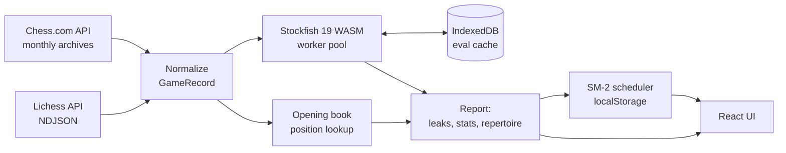

# Opening Trainer

**Find the opening mistakes you keep repeating on Lichess and Chess.com, then fix them with spaced-repetition drills built from your own games.**

[](https://github.com/abi1010-git/Opening-Trainer/actions/workflows/ci.yml)

**Live app:** https://abi1010-git.github.io/Opening-Trainer/

Free, no account, and nothing to install: Stockfish runs inside your browser.

## Why this exists

Chess sites review **one game at a time**, and course sites like Chessable teach **someone else's repertoire**. Neither tells you that you've played the same bad move in the same position in four different games, or turns that into practice.

Opening Trainer looks across all your recent games:

| | Lichess / Chess.com review | Chessable | **Opening Trainer** |
|---|---|---|---|
| Finds mistakes | Per game | – | **Across games, grouped by position** |
| Repertoire | Generic explorer | Pre-written courses | **Built from the moves you actually play** |
| Spaced repetition | – | On their courses | **On your own mistakes** |
| Works with both sites | – | – | **Lichess + Chess.com** |
| Cost | Freemium | Paid courses | **Free, runs locally** |

## Features

- **Import from Lichess or Chess.com** by username, filtered by time control (bullet / blitz / rapid / classical / daily).
- **Repeated-mistake detection.** Every opening move you play is checked by Stockfish 19. Identical mistakes are grouped by position, so "5…gxf6 in 3 games" shows up as one habit to fix, not three separate blunders.
- **Mistake explorer.** Step through the game on a board, with arrows for the move you played and the better one, the engine's best line, the opponent's punishing reply, and links back to every game.
- **Your real repertoire.** A move tree built from your own games, with your score in every branch. Lines you reach often and lose in are flagged as **weak lines**.
- **Spaced-repetition drills.** Each mistake becomes a training card using a simplified SM-2 scheduler (the algorithm Anki is based on). Positions you get wrong come back in 10 minutes; positions you get right come back after 1 day, then 3, then about 8, and so on. Any move within 0.3 pawns of the engine's choice counts, checked live by the engine, so you aren't marked wrong for a playable alternative.
- **Opening stats** by family and colour: score, mistakes per game, and the average move of your first mistake.
- **Works on phones**, and remembers your last report and drill schedule on your device.

## How it works



There is no backend. The whole app is static files, so it hosts for free on GitHub Pages and never has cold starts. Your computer does the work, so more users cost nothing extra.

### Engineering notes

- **Engine in the browser.** Uses the single-threaded Stockfish 19 WASM build, which needs no special server headers. To still use every CPU core, it runs a **pool of Web Workers** (cores − 1, up to 4) and spreads positions across them.
- **Half the engine work.** The evaluation *after* move N is the evaluation *before* move N+1, so each position is analysed once, and only positions next to *your* moves are analysed. The original Python version evaluated before and after every move separately.
- **Eval cache.** Results are cached in IndexedDB by position and depth, so openings you play repeatedly (and re-runs) are nearly free.
- **Better mistake grading.** Moves are judged by the drop in *winning chances* (the same curve Lichess uses), not raw pawns. Going from +8 to +6 is still completely winning and isn't flagged; going from 0 to −2 is.
- **Transposition-aware opening names.** Openings are identified by the *position* reached, not the move order, using the ECO dataset precompiled into a lookup table at build time and lazy-loaded.
- **Tested.** Vitest unit tests cover mistake classification, UCI parsing, both importers, opening identification, leak grouping, the SM-2 scheduler and the repertoire tree. CI runs type-checking, tests and a production build on every push.

**Stack:** React 19 · TypeScript · Vite · Tailwind CSS 4 · chess.js · Chessground (Lichess' board) · Stockfish 19 WASM · idb-keyval · Vitest · GitHub Actions / Pages

## Run locally

```bash
cd web
npm install      # also copies the Stockfish build into public/ and compiles the opening book
npm run dev      # http://localhost:5173
npm test
npm run build    # static site in web/dist
```

## Deploy

Pushing to `main` builds and deploys to GitHub Pages through [`.github/workflows/deploy.yml`](.github/workflows/deploy.yml). One-time setup: **Settings → Pages → Source: GitHub Actions**. The `web/dist` folder also works on any static host (Cloudflare Pages, Netlify, Vercel).

## Project layout

```text
web/
  src/lib/          Core logic (no UI): importers, engine pool, analysis, openings, SRS, repertoire
  src/components/   React screens: Home, Overview, Mistakes, Repertoire, Train, Board
  scripts/          Build steps: copy the Stockfish WASM build, compile data/openings.csv
  test/             Vitest unit tests
data/openings.csv   ECO opening names and move lines
app.py, src/, ...   The original Flask + server-side Stockfish prototype (Lichess only)
```

## Original version

The first version was a Flask app that ran Stockfish on a server (`app.py`; see `Dockerfile`). It's kept in the repo for reference. The web app in `web/` replaces it.

## Author

Built by **Abhijith Aravind** ([@abi1010-git](https://github.com/abi1010-git)). Feedback and issues are welcome.
